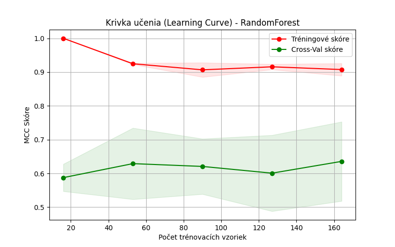
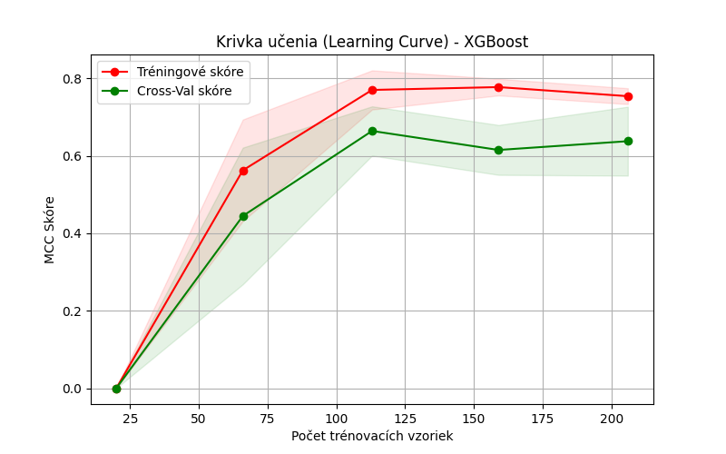

# Heart Disease Classification — Tuned XGBoost Pipeline

University ML project (BPC-UIM, Brno University of Technology). Predicts the presence of heart
disease from 13 clinical features, using **Matthews Correlation Coefficient (MCC)** as the
primary metric and an XGBoost pipeline tuned with `GridSearchCV` over stratified folds.

## Dataset

`heart-disease_data.csv` — 258 patient records, 13 clinical features and a binary `target`
column:

`age, sex, cp, trestbps, chol, fbs, restecg, thalach, exang, oldpeak, slope, ca, thal`

With only ~200 training rows after the test split, small differences in score are within
noise, so the project focuses on **honest evaluation** (stratified CV with ±1σ bands, MCC
over accuracy) rather than chasing decimal points.

## Approach

1. **Data validation before modeling** — physiologically impossible values (e.g. `age`
   outside 0–120, `chol` outside 80–700, categorical codes outside their legal domain) are
   masked to `NaN` instead of being silently kept or dropped.
2. **Leakage-safe preprocessing** — `KNNImputer` and `StandardScaler` live *inside* the
   sklearn `Pipeline`, so they are refitted on each CV fold's training part only.
3. **Hyperparameter search scored on MCC** — `GridSearchCV` over tree complexity
   (`max_depth`, `min_child_weight`), regularization (`gamma`, `reg_alpha`, `reg_lambda`)
   and sampling (`subsample`, `colsample_bytree`), using stratified 5-fold CV. MCC is the
   selection metric because the classes are imbalanced and false negatives are costly in a
   medical setting.
4. **Diagnosis with learning curves** — see below.

## Model selection story: from Random Forest to regularized XGBoost

The first candidate, a Random Forest, fit the training folds almost perfectly but generalized
poorly — a textbook overfitting signature on a small dataset:

| Model | Train MCC | Cross-val MCC |
|---|---|---|
| Random Forest | ≈ 1.0 | ≈ 0.60–0.63 |
| XGBoost (tuned) | ≈ 0.77 | ≈ 0.63 |

<details>
<summary>Learning curves (click to expand)</summary>

**Random Forest** — near-perfect training score, cross-val stuck around 0.6:



**XGBoost after tuning** — the train/validation gap narrows markedly:



</details>

This drove the switch to gradient boosting with explicit regularization: the tuned XGBoost
pipeline reaches a cross-validated MCC of ≈ 0.63 with a much smaller optimism gap, and was
submitted as the final model.

## Usage

```bash
python -m venv .venv
# Windows:  .venv\Scripts\activate      Linux/macOS:  source .venv/bin/activate
pip install -r requirements.txt
python train_xgboost.py
```

The script prints the top-10 parameter sets by cross-validated MCC, the final held-out test
metrics (MCC, F1, accuracy, recall), and saves the fitted pipeline to
`final_pipeline_XGBoost.joblib`. A pipeline trained during the project is already committed
for inspection.

> ⏱️ The committed `PARAM_GRID` is intentionally thorough (864 configurations × 5 folds ×
> 3000 trees). On a laptop CPU this takes a while — shrink the grid or `n_estimators` for a
> quick run.

## Project layout

| Path | Purpose |
|---|---|
| `train_xgboost.py` | End-to-end pipeline: cleaning → preprocessing → grid search → evaluation → model export |
| `heart-disease_data.csv` | Dataset (258 × 14) |
| `final_pipeline_XGBoost.joblib` | Trained pipeline artifact |
| `figures/` | Learning curves used above |

## Notes

- Console output from the script is in Slovak/Slovak-Czech (course language); this README and
  the code structure are in English.
- Course submission project — the analysis is exploratory and results are specific to this
  small dataset.
